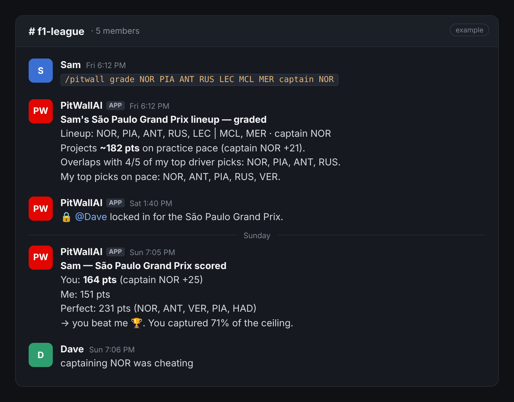
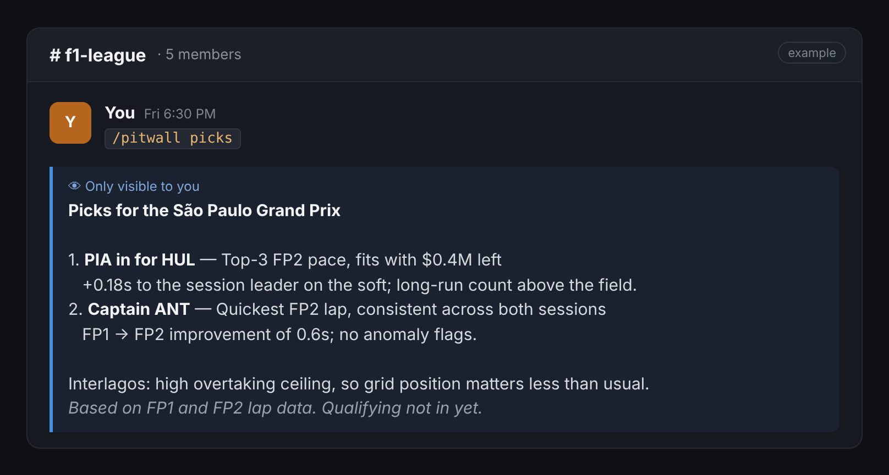

# PitWallAI

> An F1 Fantasy companion for your friends' league, living in your Slack.

> **Independent fan project.** Not affiliated with, endorsed by, or connected to Formula 1, F1 Fantasy, the FIA, or any team or driver. Picks are informational only, for use within the F1 Fantasy game. Not financial, betting or investment advice. See [DISCLAIMER.md](DISCLAIMER.md).

[](https://github.com/whitjenk/pitwallai/actions/workflows/ci.yml)
[](https://www.python.org/downloads/)
[](LICENSE)

PitWallAI is a Slack bot for an F1 Fantasy league. Everyone saves their team and gets private transfer and captain reads built from real practice lap data. Lineups get graded, locked and scored in the league channel, and the bot plays along with its own pick every weekend, so there's always someone to beat.



---

## Commands

Everything goes through one slash command. Personal things are only visible to you. League banter posts in the channel.

| Command | What it does | Who sees it |
|---|---|---|
| `/pitwall team ANT LEC ALO HUL LAW MER FER budget 1.5 transfers 2` | Save your squad. `budget` is the money **left** after your team, not the $100M cap | Only you |
| `/pitwall team` | Show your saved squad | Only you |
| `/pitwall picks` | Transfer and captain reads for the next race | Only you |
| `/pitwall grade <lineup> captain XXX` | Grade a lineup against practice pace and the bot's picks | Channel |
| `/pitwall lock <lineup> captain XXX` | Lock your call for the next race | You, plus a one-liner in the channel (no lineup shown) |
| `/pitwall score [race]` | Your locked call vs the bot vs the result vs the perfect lineup | Channel |
| `/pitwall record` | Your season so far vs the bot | Channel |
| `/pitwall forget` | Erase everything the bot stores about you | Only you |

Drivers and constructors can be three-letter codes (`ANT`, `MER`) or names (`antonelli`, `mercedes`). Add a chip with `3x`, `limitless`, `wildcard`, `no negative`, `autopilot` or `final fix`.



---

## A race weekend with PitWallAI

| When | What to do |
|---|---|
| **Friday, after FP2** | `picks` and `grade`. This is the first time real practice pace is in |
| **Saturday, before qualifying** | `lock` your final lineup (F1 Fantasy locks at qualifying) |
| **Sunday, after the race** | `score`, then `record` for the season table |

**Timing note:** the free [OpenF1](https://openf1.org/) data the bot uses is paused from 30 minutes before each live session until 30 minutes after it. During that window, commands that need fresh data may not answer. Fixing this is on the [roadmap](docs/delegation/ROADMAP.md).

---

## Try it

### From the terminal (no Slack needed)

```bash
git clone https://github.com/whitjenk/pitwallai.git
cd pitwallai
uv venv -p 3.11 .venv && source .venv/bin/activate   # uv downloads Python 3.11 if needed
uv pip install -r requirements.txt
python scripts/pitwall_cli.py                        # type commands like `help`, `picks`
```

The CLI runs the same handlers as the Slack bot against a separate local database (`pitwall-cli.sqlite`), and labels every reply **PRIVATE** or **CHANNEL**. Use `--user sam` to act as a different league-mate. No `uv`? Install it with `brew install uv` or see [docs.astral.sh/uv](https://docs.astral.sh/uv/).

### In Slack

Create a Slack app from the included manifest, add two tokens, and run `python -m slack_app`. It uses Socket Mode, so there's no public URL or webhook to host. **[docs/slack_setup.md](docs/slack_setup.md)** walks through it step by step, including deploying on Railway (about $5 a month).

---

## How it works

```
OpenF1 laps & sessions ─┐
F1 Fantasy prices ──────┤
                        ▼
                     core/         rules, prices, practice-pace projections,
                                   transfers, grading, scoring (pure, no database)
                        │
          store/  ◄─────┼────►  slack_app/   /pitwall handlers + Slack (Bolt, Socket Mode)
   one SQLite file:     │
   teams, locks, cache  ▼
                     your league's Slack channel
```

- **Picks come from practice lap pace**: gap to the session leader, FP1 → FP2 improvement, long-run counts and teammate gaps, plus the qualifying grid once it's set and how easy the circuit is to overtake at.
- **Evidence, not instructions.** The bot says what it saw ("+0.18s to the leader on the soft") rather than telling you what to do. A linter in CI enforces that wording.
- **Prices stay current**: they refresh from the game's price feed at startup and every 12 hours.

Developer notes: **[TECHNICAL.md](TECHNICAL.md)**.

---

## How this repo is built

Most changes are made by AI coding agents working from short written briefs, with a human picking the work, reviewing and merging. The playbook, the briefs and the roadmap are in **[docs/delegation/](docs/delegation/)**. Agent conventions live in [CLAUDE.md](CLAUDE.md). Contributions follow the same loop: open an issue with a brief (see [BRIEF_TEMPLATE.md](docs/delegation/BRIEF_TEMPLATE.md)).

## License

MIT. See [LICENSE](LICENSE).
