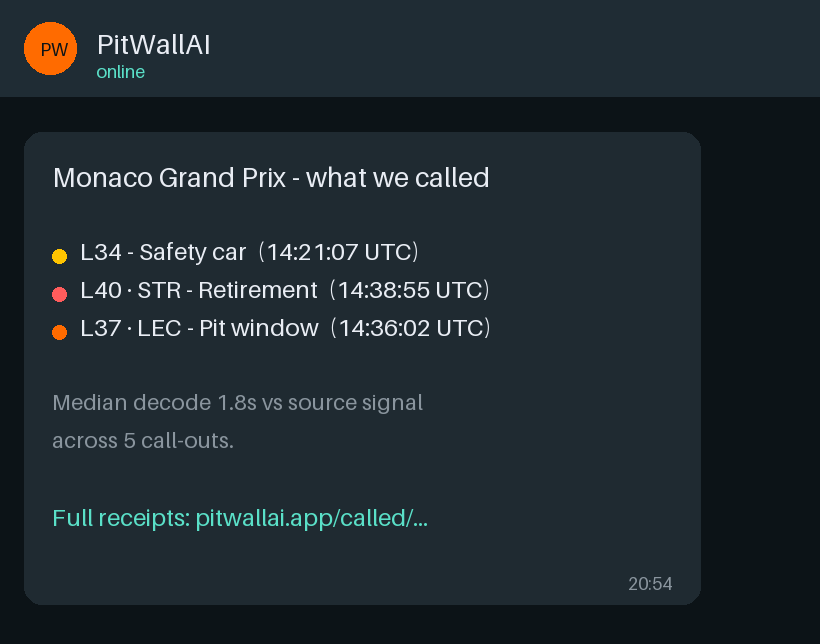

# PitWallAI

> The most useful thing an F1 fantasy fan has on race weekend.

> **Independent fan project.** PitWallAI is not affiliated with, endorsed by, or connected to Formula 1, F1 Fantasy, ESPN, or any F1 team or constructor. All recommendations are informational only and intended for use within the F1 Fantasy game. Nothing here constitutes financial, betting, or investment advice.

PitWallAI is an open-source F1 fantasy companion on WhatsApp. Every Sunday it logs the strategic moments of the race — safety cars, retirements, pit windows — each stamped with the source-signal time and our decode time, so you can forward your league chat exactly what we saw and when. Across the weekend it also sends personalized, budget-aware picks before lock, and scores every one against the actual race result.



[](https://www.python.org/downloads/)
[](LICENSE)
[](https://github.com/whitjenk/f1-tactical-intelligence-hive/actions/workflows/ci.yml)
[](https://openf1.org/)

---

## What it does

**The receipts (Sunday).** During the race, **RaceMonitor** logs every strategic moment as PitWallAI sees it — safety cars, retirements, pit windows, weather flips — each saved with its source-signal time and our decode time. After the flag, **CalledRecap** drops a forwardable summary to your WhatsApp with a shareable link (`/called/{token}`), so you can show your league chat exactly what we saw and when. This is the part that works from race one — no track record required to be useful.

**The picks (Thursday → Saturday).** Across the weekend you also get personalized picks before lock — filtered to your actual team, remaining budget, and available transfers — and every pick is scored against the real race result. The model re-weights its own signals each week, so the picks get sharper over the season as results accumulate.

Backed by **three agents** that run across the weekend (the pre-lock pipeline is one agent with three stages).

**PicksAgent (Thursday → Saturday)** — three stages, one versioned pipeline:

- **Thursday (context)** — circuit history, championship pressure per driver, weather forecast, FIA directives.
- **Friday (practice)** — FP1/FP2 lap pace and statistical anomalies (e.g. a driver 0.8s off teammate pace, or slower in FP2 than FP1).
- **Saturday (quali)** — your team, budget, and qualifying result; models legal transfer combinations and sends the swap that pencils out.

**Sunday (race)** — **RaceMonitor** watches the OpenF1 stream and timestamps every strategic moment as PitWallAI sees it: safety cars, retirements, pit windows, weather flips. The picks are already locked — the value here is *receipts*. Each call-out is saved with its source-signal time and our decode time so you can show your league chat afterward what we saw and when.

**Sunday night** — **ScorerLearner** logs every pick against the actual result and updates season accuracy + signal-quality weights. **CalledRecap** drops a forwardable summary of the weekend's call-outs to your WhatsApp with a shareable link (`/called/{token}`) — same idea as the season recap, but for live race intelligence.

---

## Subscribe

Text **SUBSCRIBE** to the PitWallAI WhatsApp number (set `WHATSAPP_DISPLAY_NUMBER` in production — generate a QR with `python scripts/generate_subscribe_qr.py`).  
Send a screenshot of your F1 Fantasy **My Team** screen (or text **TEAM**) to set up your squad.  
Text **HELP** for commands · **UNSUBSCRIBE** to stop messages · **DELETE** to erase your data ([PRIVACY.md](PRIVACY.md)).

*Closed beta — free, open source, no app required. Operator checklist: [BETA_INVITE.md](BETA_INVITE.md).*

---

## Season GP pick hit rate

Picks are scored against **Grand Prix race results** using the official F1 Fantasy race points scale (not qualifying or sprint). Updated after every race.

[Link to live leaderboard]

---

## Run it yourself

No API key required to boot the server locally:

```bash
git clone https://github.com/whitjenk/f1-tactical-intelligence-hive.git
cd f1-tactical-intelligence-hive
python3.11 -m venv venv && source venv/bin/activate
pip install -r requirements.txt
python main.py
# PitWallAI → http://localhost:8000/
```

To try the WhatsApp commands without a phone number, use the terminal simulator:

```bash
python scripts/whatsapp_chat.py
# then type: PICKS
```

Picks are built from real OpenF1 FP1/FP2 lap data — no live WhatsApp connection needed.

---

## How it works

**Three agents.** One orchestrator (`LeadStrategist`). One shared `RaceContext` across the weekend.

`PicksAgent` owns Thursday–Saturday as three **stages** (`context` → `practice` → `quali`). Stage logic still lives in `agents/context_builder.py`, `practice_analyst.py`, and `quali_strategist.py` for testing — the consolidation is the *named interface*, not a merge of code paths.

```
Thursday–Saturday (PicksAgent)          Sunday              Post-race
────────────────────────────────────────────────────────────────────
 context → practice → quali      RaceMonitor        ScorerLearner
         │                              │                    │
         └──────────────┬───────────────┴────────────────────┘
                    LeadStrategist
                          │
                  WhatsApp → Fan
```

Practice signals come from real OpenF1 FP1/FP2 lap data (OpenF1 never publishes
radio transcripts), synthesised into a `PracticeSignal` per driver per session:

```
OpenF1 REST (/v1/laps, /v1/drivers) → build_lap_only_signals
        │
        ▼
PracticeSignal (Pydantic v2)
  ├── pace_satisfaction: float   ← gap to session leader
  ├── setup_sentiment: float     ← pace standing + FP1→FP2 improvement
  ├── tire_confidence: float     ← timed-lap count vs the field
  └── anomaly_flags: list[str]   ← teammate_gap_*, session_regression, short_long_run_count
```

→ Deeper architecture, CLI, tests, and data-science notes: **[TECHNICAL.md](TECHNICAL.md)**

---

## Design principles

**Evidence, not instructions.** Signals carry a `raw_evidence` trail (e.g. "lap-only: best 78.4s, +0.3s to leader"), not a `recommended_action`. The system tells you what it saw and what history says about it. You decide. A fan who second-guesses their read because an AI gave a conflicting instruction has lost something. That is not a tool — that is a liability.

**Provenance over assertion.** Every pick and recap shows the evidence that drove it — lap gaps, anomaly flags, qualifying grid — so you can check the reasoning rather than take it on faith.

---

## Stack

| Layer | Technology |
|---|---|
| Agent orchestration | PydanticAI (model-agnostic) |
| Default LLM | Gemini 2.0 Flash via Vertex AI |
| BYOK | Claude / GPT-4o-mini / Ollama |
| Live data | OpenF1 API (REST) |
| Async runtime | asyncio |
| API server | FastAPI + uvicorn |
| Database | Postgres (Railway) |
| Delivery | WhatsApp Cloud API |

---

## Contributing

Contributions are open. The **3-agent** topology (`PicksAgent`, `RaceMonitor`, `ScorerLearner`) is the current contract — see [TECHNICAL.md](TECHNICAL.md) for stage schedules, WhatsApp commands, and data models. New weekend logic should extend an existing stage or agent, not add a fourth top-level agent without discussion. Pattern: typed `AgentRunDependencies`, Pydantic v2 outputs, asyncio-native, `PIPELINE_VERSION` bump in [pitwallai/version.py](pitwallai/version.py) when behaviour changes.

## Disclaimer

PitWallAI is an independent open-source fan project. It is **not** affiliated with, endorsed by, or sponsored by Formula One Licensing B.V., the FIA, or the official [F1 Fantasy](https://fantasy.formula1.com/) game. F1, Formula 1, and related marks are trademarks of their respective owners.

**AI-generated intelligence.** Picks, recaps, and other outputs may use rules engines, statistical models, and large language models. They can be wrong, incomplete, or out of date — especially when data is missing, sessions change, or the official game applies penalties after the fact. PitWallAI is **not** financial or betting advice. You are responsible for your own fantasy decisions; always verify lineup, budget, transfers, and lock time in the official F1 Fantasy app.

Fantasy scoring and prices in this repo are simplified approximations of published game rules — always confirm transfers and points in the official app before lock.

Live timing and session data may be sourced from [OpenF1](https://openf1.org/) and other public APIs; see their terms for attribution and use.

WhatsApp is a trademark of Meta Platforms, Inc. Subscribers opt in via **SUBSCRIBE** and can opt out with **UNSUBSCRIBE** or erase all data with **DELETE**. See [PRIVACY.md](PRIVACY.md) for what we store and how deletion works.

## Legal

PitWallAI is an independent fan project not affiliated with Formula 1, F1 Fantasy, ESPN, or any F1 constructor. All picks are informational only. See [DISCLAIMER.md](DISCLAIMER.md) for full terms.

## License

MIT
